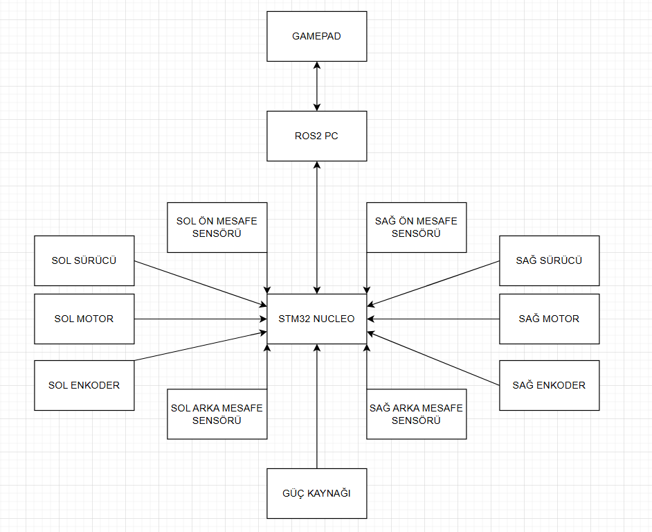

# AMR-01 - İlk sistem blok şeması incelemesi

Tarih: 12 Ekim 2026. Şemayı çizen: Arda. İnceleme ve açıklama desteği: AI. Durum: ilk taslak alındı; yönler, akış etiketleri ve güç dağıtımı düzeltilecek. Bu belge bitmiş tasarım veya devre bağlantı şeması değildir.

## Arda'nın önerisi

Gamepad ile ROS 2 bilgisayarının, bilgisayar ile STM32 Nucleo'nun çift yönlü bağlantısı gösterildi. Sol/sağ sürücü, motor ve enkoderler; dört köşe mesafe sensörü; güç kaynağı yerleştirildi. Enkoder ve sensör okları STM32'ye yöneldi. Bileşenlerin görev açıklamaları ve okların taşıdığı veri/enerji henüz yazılmadı.

Gamepad + ROS 2 PC, ilk manuel kontrol için aday mimaridir. Gamepad modeli/bağlantısı, bilgisayarın harici veya robot üstünde olması, Nucleo modeli ve sensör türleri henüz seçilmedi. Dört sensör önerisi satın alma kararı veya V0 kabulüne eklenmiş zorunlu özellik değildir.

## İnceleme

| Şemadaki ilişki | Değerlendirme / öğrenme noktası |
| --- | --- |
| Gamepad ↔ ROS 2 PC | Sürüş için gerekli veri gamepad'den bilgisayara düğme/eksen durumudur. Ters okun taşıdığı bir işlev yoksa kaldırılabilir; USB/Bluetooth'un fiziksel çift yönlülüğü işlevsel sürüş akışından ayrıdır. |
| ROS 2 PC ↔ STM32 | İki yön anlamlıdır; ayrı oklarla bilgisayardan hız/durma komutu, STM32'den enkoder/hız/durum geri beslemesi etiketlenecek. |
| Sol/sağ sürücü → STM32 | Motor kontrol komutu için yön ters: STM32 → sürücü. Sürücü durum/hata çıkışı ayrıca seçilirse ters yönde ayrı bir ok eklenebilir. |
| Sol/sağ motor → STM32 | Temel sürüşte motor doğrudan STM32'nin kontrol çıkışına bağlanmaz. Sürücü → motor enerji aktarımı eksik. Ölçüm yolu enkoder → STM32 olarak gösterilir. |
| Enkoder → STM32 | Ölçüm yönü uygun. Enkoderin ilgili motor/tekerlek dönüşünü ölçtüğü mekanik ilişki de gösterilmeli; elektriksel besleme ayrı akıştır. |
| Köşe mesafe sensörleri → STM32 | Tür ve arayüz uyumuna bağlı bir ölçüm yolu adayı. STM32'de okunan mesafenin ROS 2'ye nasıl aktarılacağı ve hangi işlevde kullanılacağı henüz açıklanmadı. |
| Güç kaynağı → STM32 | Enerji dağıtımı eksik. Motor sürücülerine ve sensör/enkoder/lojik bileşenlerine uygun besleme yolları; bilgisayarın kendi beslemesi veya robot güç dağıtımıyla beslenmesi gösterilmeli. Gerilimler henüz seçilmeyecek. |

Kontrol sinyali ile motorun besleme enerjisi farklıdır. Sürücü hem kontrol sinyalini hem motor beslemesini alır; motor akımını sürücü üzerinden yönetir. Bu nedenle STM32, motor sürücü ve motor için tek tür ok kullanmak yanlış anlamaya açıktır.

## Haritalama sensörü ile yakın mesafe algısı

Şemadaki dört mesafe sensörünün türü belirtilmedi. Tek yönlü yakın mesafe ölçümleri kastediliyorsa, bunları doğrudan başlangıç planındaki 2D SLAM sensörünün yerine kabul etmiyoruz. Yakın engel algılama ile haritalama veri ihtiyacı ayrı değerlendirilecek.

Nav2'nin Jazzy haritalama/konumlanma rehberinde slam_toolbox ve AMCL için LaserScan verisi kullanılıyor; sonar/IR verisinin costmap'e katılması ayrı range katmanında açıklanıyor. Bu ayrımdan hareketle, köşe sensörleri yardımcı yakın mesafe algısı adayı; V1 haritalama için uygun tarama sensörü ise ayrı seçim konusu olarak tutulur. Sensörler tamamen kör noktaları kapatıyor veya her engeli algılıyor varsayılmadı.

V1 şemasına “haritalama sensörü - tür/model AMR-12'de seçilecek” bloğu eklenebilir; uygun arayüz üzerinden ROS 2 bilgisayarına veri sağlayacağı gösterilir. V0 için bu donanımı hemen almak veya çalıştırmak gerekmiyor.

Kaynaklar (erişim: 12 Ekim 2026):

- [Nav2 Jazzy - Mapping and Localization](https://docs.nav2.org/jazzy/configuration_and_development/first_time_robot_setup_guide/sensors/mapping_localization/): haritalama/konumlanma ve range katmanı ayrımı.
- [SLAM Toolbox resmî deposu](https://github.com/SteveMacenski/slam_toolbox): LaserScan girişinin tanımı. Kurulu dağıtımın sürümü bu oturumda doğrulanmadı.

## Arda'nın sonraki uygulaması

Mevcut şemayı düzelt; AI tarafından hazırlanmış yeni bir şema kopyalamak yerine kendi çizimini geliştir:

1. Komut, ölçüm/geri besleme ve enerjiyi üç renk veya çizgi biçimiyle ayır; bir açıklama kutusu ekle.
2. Motor sürücü ve motor yollarını düzelt; enkoderin ölçtüğü motorla ilişkisini göster.
3. PC-STM32 çift yönünü ayrı veri okları olarak etiketle. Gamepad ters oku kalacaksa işlevini yaz.
4. Besleme dallarını göster; model/gerilim seçimini boş bırak. Harici bilgisayar kullanımı düşünülüyorsa ayrı besleme olarak işaretle.
5. Köşe sensörlerini yardımcı aday, haritalama sensörünü V1 bloğu olarak ayır. V0'a zorunlu sensör kabulü ekleme.
6. Her bloğa bir cümle görev yaz. Özellikle STM32'nin periyodik motor kontrolü ve komut kaybında durma sorumluluğunu belirt.

Kendi sözlerinle açıklama: STM32 neden motor sürücüye ihtiyaç duyar? Enkoder nasıl geri besleme sağlar? ROS bilgisayarı mesaj göndermeyi bırakırsa hangi blok hangi davranışı uygulamalıdır? Bu cevaplar henüz alınmadı.
