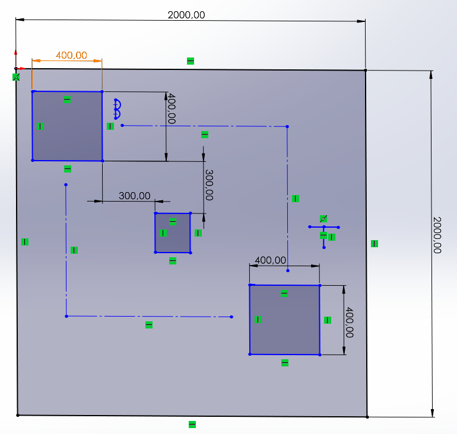

# AMR-01 - Varsayımsal test alanı

Tarih: 12 Ekim 2026. Kaynak: Arda'nın CAD çizimi ve açıklaması. Bu bir tasarım varsayımıdır; fiziksel ölçüm veya navigasyon deneyi değildir.

| Özellik | Değer / durum |
| --- | --- |
| Alan | 2,00 × 2,00 m kare |
| Robot gövde izdüşümü | 0,40 × 0,40 m; Arda'nın geçici boyut varsayımı |
| Zemin | Düz zemin; önceki kullanım senaryosuyla uyumlu varsayım |
| Rota fikri | İki alternatif yol; çizimde iki kesikli hat |
| Base/target/engel kimliği | Açık metin etiketleriyle netleştirilecek |
| Engel boyutu ve konumu | Çizimde orta kare ve 300 mm ofsetler var; engel ölçüleri ayrıca belirtilecek |
| En dar geçiş ve operatör yeri | Henüz açıkça belirtilmedi |

## İnceleme notu

Çizimdeki 2000 ve 400 ölçüleri, Arda'nın 2 m alan / 40 cm robot açıklamasıyla uyumludur. İki alternatif rota fikri kaydedildi; iki rotanın ortak başlangıç ve hedefi ile robot merkezini temsil edip etmediği netleştirilecek.

Bir çizginin engeli kesmemesi, 40 cm genişliğindeki gövdenin geçebildiğini tek başına göstermez. Eksenlere paralel kare gövdenin merkezinden kenara 20 cm vardır; ilave açıklık ayrıca seçilecektir. Dönüşte gövdenin kapladığı alan da hesaba katılır. Çizimdeki 300 mm ölçülerin koridor genişliği olduğu varsayılmadı. Gerçek bir koridor 30 cm genişliğinde olsaydı, 40 cm kare robot bu aralıktan geçemezdi.

Bu aşamada ayrıntılı rota doğrulaması yapılmayacak. AMR-01 çıktısı, alan ve geçiş varsayımlarını açık yazmaktır; kinematik/model ve navigasyon incelemesi sonraki görevlerde yapılacaktır.

## Küçük çizim düzeltmesi

- “Varsayımsal test alanı - ölçüler mm” notunu ekle.
- Robot/Base, Target ve Engel etiketlerini açık yaz; operatörün yerini göster.
- İki rotanın aynı robot merkezinden başlayıp aynı hedef merkezine ulaştığını göster; merkez yoluysa bunu not et.
- En dar gerçek geçişi yüzeyden yüzeye ölçülendir; 300 mm ofset ile geçiş genişliğini ayır.

Ardından AMR-01'in sistem sorumlulukları ve üç akış blok şeması adımına geçilecek. Çizim, robotun iki rotayı başarıyla izlediğine dair kanıt değildir.
