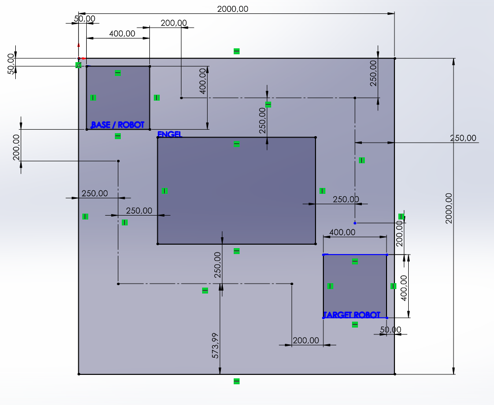

# AMR-01 - Varsayımsal test alanı

Tarih: 12 Ekim 2026. Kaynak: Arda'nın CAD çizimi ve açıklaması. Bu bir tasarım varsayımıdır; fiziksel ölçüm veya navigasyon deneyi değildir.

İlk çizim [v01](../evidence/AMR-01/alan-cizimi-v01.png) olarak korundu; güncel inceleme v02'ye aittir. Alan tanımı AMR-01'in sistem sorumlulukları adımına geçmek için yeterlidir. Rota uygulama kabulü yapılmadı.

| Özellik | Değer / durum |
| --- | --- |
| Alan | 2,00 × 2,00 m kare |
| Robot gövde izdüşümü | 0,40 × 0,40 m; Arda'nın geçici boyut varsayımı |
| Zemin | Düz zemin; önceki kullanım senaryosuyla uyumlu varsayım |
| Rota fikri | İki alternatif yol; çizimde iki kesikli hat |
| Base/target/engel kimliği | V02'de BASE / ROBOT, TARGET ROBOT ve ENGEL etiketleri var |
| Gösterilen yol açıklıkları | Üst, sol ve sağda duvar-yol merkezi 250 mm; yol merkezi-engel yüzeyi 250 mm; bu kesitlerde toplam boşluk 500 mm |
| Başlangıç/hedef gövde açıklığı | Base'te üst/sol; target'ta sağ duvara gövde açıklığı 50 mm gösterildi |
| Operatör yeri | Henüz belirtilmedi; alan dışı konum ayrıca not edilecek |

## İnceleme notu

Çizimdeki 2000 ve 400 ölçüleri, Arda'nın 2 m alan / 40 cm robot açıklamasıyla uyumludur. İki alternatif rota fikri ve istasyon/engel etiketleri kaydedildi. Kesikli hatlar incelemede robot merkezi yolu olarak yorumlandı; Arda'nın açık notuyla teyit edilecek. Çizimde rotaların base/target merkezlerine kısa bağlantıları tam gösterilmemiştir; bu ayrıntı sonraki rota modellemesinde tamamlanabilir.

Bir çizginin engeli kesmemesi, 40 cm genişliğindeki gövdenin her yönelimde geçebildiğini tek başına göstermez. Eksenlere paralel kare gövdenin merkezinden kenara 200 mm vardır. Gösterilen 250 mm merkez-yüzey uzaklığı, bu duruşta 250 - 200 = 50 mm nominal gövde açıklığı verir. Bu değer ölçülmüş güvenli çalışma mesafesi değildir.

Yerinde dönen kare gövde için merkezden köşeye uzaklık yaklaşık 283 mm'dir (200 × √2). Duvara 250 mm uzak bir merkez etrafında tam yönelim taraması yeterli açıklığı sağlamaz. Özellikle duvar yakınındaki rota köşeleri, dönüş modeli ve seçilecek ek açıklıkla sonraki görevlerde gözden geçirilecek. İki rotanın çarpışmasız olduğu henüz doğrulanmadı.

Bu aşamada ayrıntılı rota doğrulaması yapılmayacak. AMR-01 çıktısı, alan ve geçiş varsayımlarını açık yazmaktır; kinematik/model ve navigasyon incelemesi sonraki görevlerde yapılacaktır.

## Kalan küçük notlar ve sonraki adım

- “Varsayımsal test alanı - ölçüler mm; kesikli hatlar robot merkezi yolu” notunu teyit ederek ekle.
- Operatörün alan dışındaki konumunu not et.
- Base/target bağlantıları ve dönüşte gövde taraması, sonraki model/rota incelemesinde ele alınacak; bugün ayrıntılı rota optimizasyonu gerekmiyor.

Şimdiki uygulama AMR-01'in sistem sorumlulukları ve üç akış blok şemasıdır. Çizim, robotun iki rotayı başarıyla izlediğine dair kanıt değildir.
